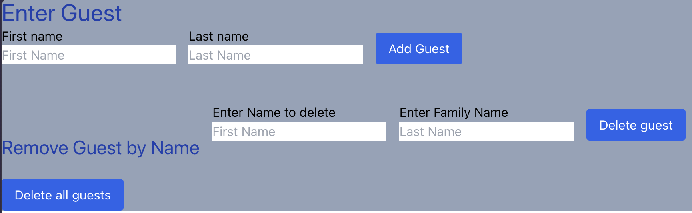
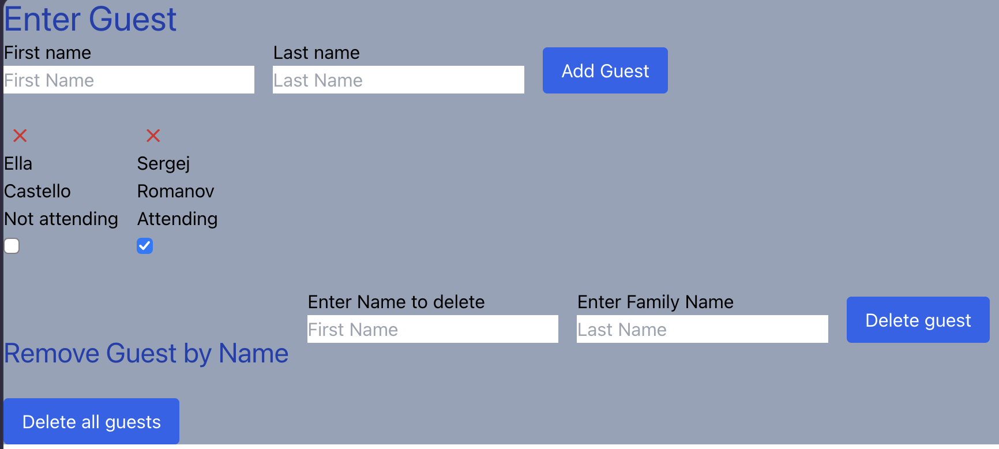

# React Guest List

A simple guest list that allows to add and remove guests and configure their attending status. [React Guest List](https://react-guest-list-kb.netlify.app/)

It uses an [REST API from UpLeveled](https://github.com/upleveled/express-guest-list-api-memory-data-store) to store and modify the data. POST, PUT and DELETE functions are implemented.
The API is deployed via Render and the website is deployed via Netlify.

## Screenshots

## Technologies

- [ReactJs](https://react.dev/)
- [ExpressJs](https://expressjs.com/)
- [Render](https://render.com/)
- [Netlify](https://www.netlify.com/)
